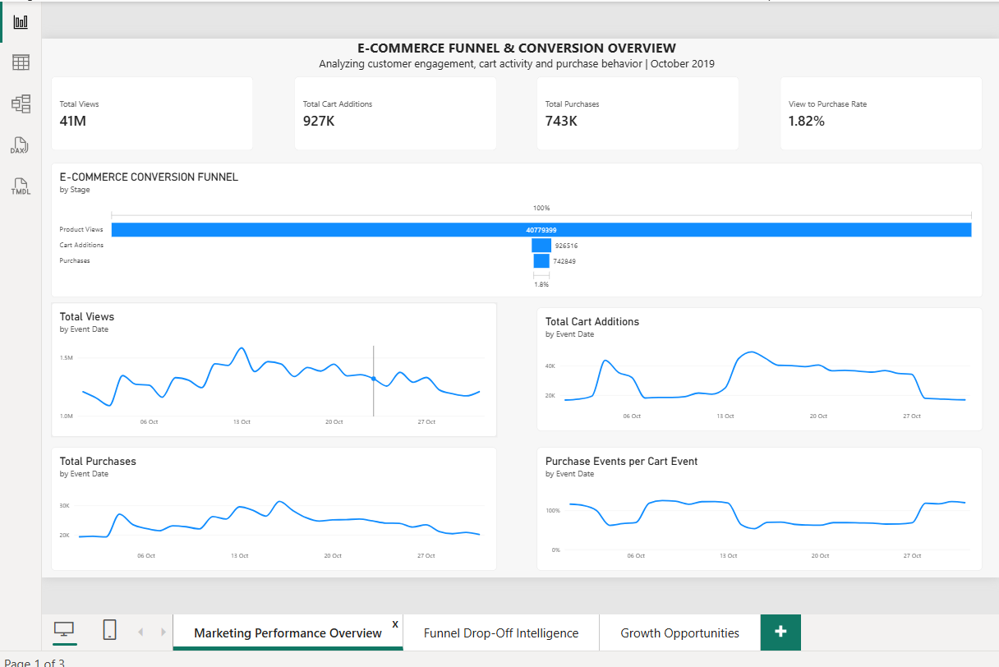
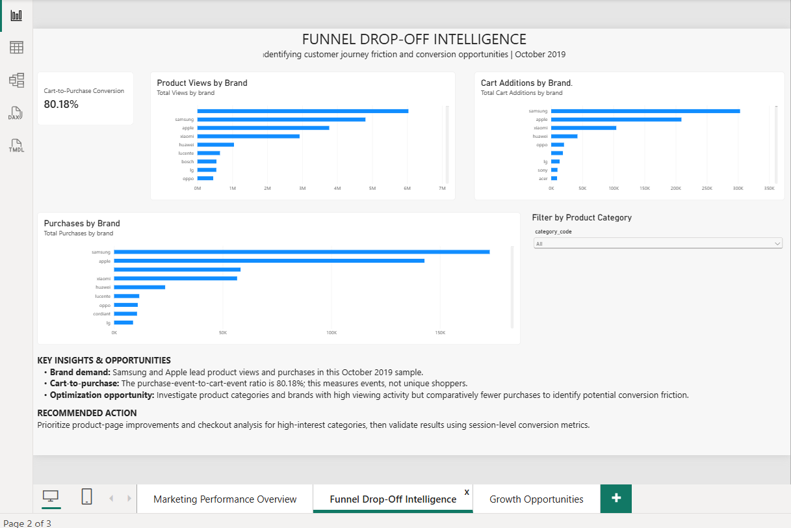
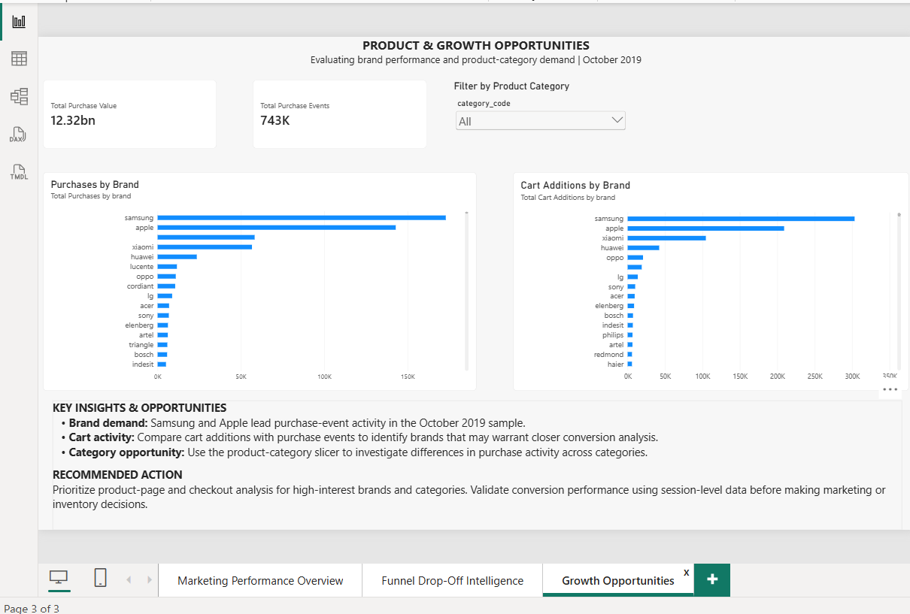

# E-Commerce Funnel & Conversion Analytics

A Power BI project analyzing e-commerce customer engagement, cart activity, purchase events, and brand-level demand using the October 2019 sample from the E-Commerce Behavior dataset.

## Project Overview

The goal is to explore customer journey activity, measure event-level conversion, identify high-demand brands, and highlight opportunities for deeper product and checkout analysis.

## Tools & Technologies

- **Power BI Desktop** — Interactive dashboards and data visualization
- **Power Query** — Data preparation
- **DAX** — Measures and calculations
- **CSV / Excel data** — Source data analysis

## Dashboard Pages

### 1. Marketing Performance Overview
- Total product views, cart additions, and purchase events
- View-to-purchase event ratio
- Funnel visualization and daily activity trends

### 2. Funnel Drop-Off Intelligence
- Cart-to-purchase event ratio
- Product views and cart additions by brand
- Product category filtering

### 3. Product & Growth Opportunities
- Purchases by brand
- Cart additions by brand
- Category filtering and actionable recommendations

## Key Findings

- Samsung and Apple show substantial product-view and purchase-event activity in the October 2019 sample.
- The overall purchase-event-to-view-event ratio is approximately **1.82%**.
- The cart-event-to-purchase-event ratio is approximately **80.18%**.
- Brands and categories with high viewing activity but comparatively fewer purchase events warrant further investigation.

## Recommendations

- Examine product pages and checkout journeys for potential friction.
- Compare cart and purchase activity across brands and product categories.
- Validate event-level findings with session-level conversion metrics before making business decisions.

## Dataset

Source: [E-Commerce Behavior Data from Multi-Category Store — Kaggle](https://www.kaggle.com/datasets/mkechinov/ecommerce-behavior-data-from-multi-category-store)

This dashboard uses the **October 2019 sample**. Event counts are not equivalent to unique users or sessions, and the observed ratios should not be interpreted as user-level conversion rates.

## Dashboard Screenshots

### Page 1 — E-Commerce Conversion Overview

### Page 2 — Funnel Drop-Off Intelligence

### Page 3 — Product & Growth Opportunities

## Project Note

This project is intended for learning and analytical demonstration. Findings describe the selected dataset sample and do not represent verified results for a specific business.

**Created by:** Gandharva Shetty  
**Tools:** Power BI, Power Query, DAX
